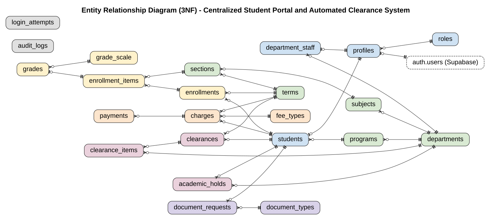
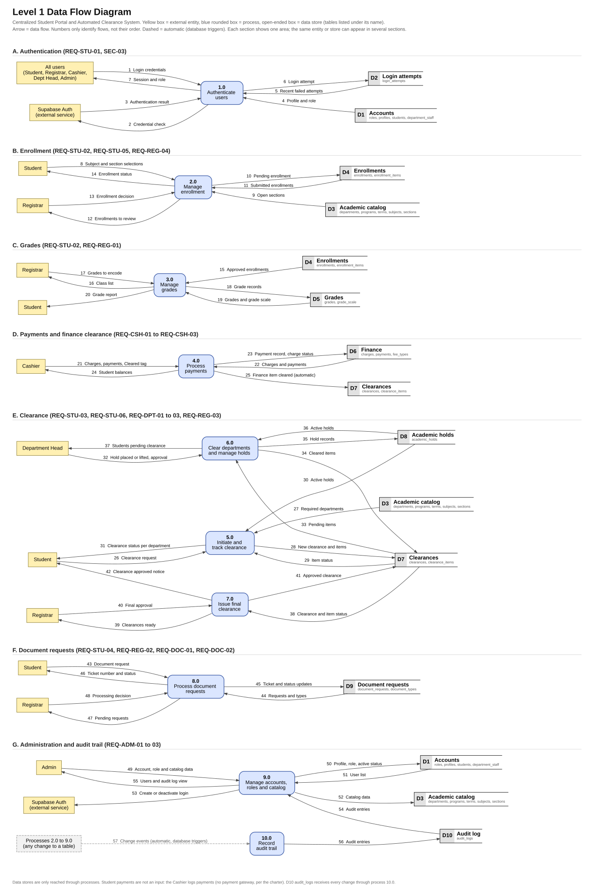
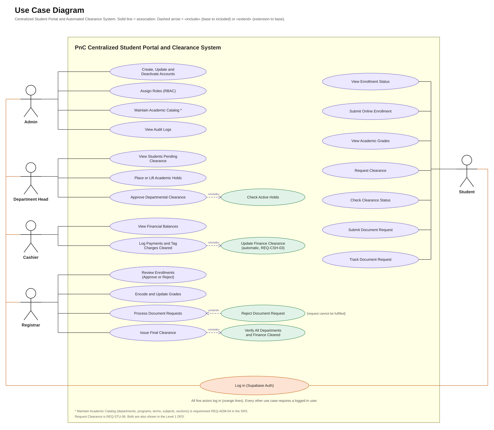

# System Requirements & Project Documentation

**Project Title:** Centralized Student Portal and Automated Clearance System
**Institution:** Pamantasan ng Cabuyao (PnC) - BS Computer Science
**Project Manager:** Abarquez, Justinbril
**Back-End Developer:** Cruzante, Aaron; Canayong, Ron
**Front-End Developer:** Esgana, Justine; Espedilon, Arvien; Dominado, Byrone
**Project Duration:** 12 Days (Agile, five iterative sprints)
**Tech Stack:** Next.js, Tailwind CSS, Supabase (PostgreSQL), Vercel

---

## Revision Log (v3)

This revision aligns the document with the database design files (`schema.sql`, `Database_Design_ERD_3NF.docx`) and the diagram files (`ERD_overview.svg`, `ERD_detailed.svg`, `DFD_level1.svg`, `UseCase_Diagram.svg`), which are the source of truth. It replaces the earlier v2 log.

| # | Change | Where |
| --- | --- | --- |
| 1 | ERD section rewritten for the 23-table design, using the exact table names of `schema.sql`. Figure 1 is `ERD_overview.svg`; `ERD_detailed.svg` is the full reference. | Part 3, Section 1 |
| 2 | Mermaid DFD and Use Case code replaced by `DFD_level1.svg` and `UseCase_Diagram.svg`, with updated descriptions (10 processes, 10 data stores, 7 sections; 5 actors). | Part 3, Sections 2 and 3 |
| 3 | Added REQ-ADM-04 (academic catalog maintenance). | SRS 3.5 |
| 4 | REQ-STU-06 replaced: students request their term clearance and track its status. The notifications requirement was removed because no table supports it. | SRS 3.1 |
| 5 | Wording and table names aligned with `schema.sql` in: definitions (Hold, Clearance Item), user classes (Cashier, Admin), assumption on Finance, REQ-REG-03, REQ-CSH-02, REQ-CSH-03, REQ-DPT-03, REQ-ADM-01, REQ-ADM-03. | SRS 1.2, 2.1, 2.2, 3.2 to 3.5 |
| 6 | Edits outside the requested sections, listed in full below the table. | Charter, SRS, Part 4 |
| 7 | Review fixes: SEC-02 `users` replaced by `profiles`; "ERD v2" changed to "ERD v3" (Phase 2 row, `types/` note); Financial Tracking objective reworded; Phase 1 date marked with a TODO comment (date unchanged). | Charter, SRS 4.1, Part 4 |
| 8 | Development methodology changed from Rapid Application Development (RAD) to Agile. RAD wording replaced in the header, team roles and SRS 2.2; new Charter section 7 describes the Agile process. | Header, Charter 4 and 7, SRS 2.2 |


**Row 6 details (edits outside the sections I was asked to edit):**

* Charter, Section 5: removed the caption line "Table data sourced from Project Charter."
* Charter, Section 6 (schedule): Phase 2 row now starts with "ERD v3 finalized and migrated (see Revision Log)"; Phase 3 row has an added sentence on starting the clearance logic first. No dates were changed.
* SRS 1.2: the Hold definition was reworded and a Clearance Item row was added.
* SRS 2.1: the Cashier, Department Head, and Admin rows were reworded.
* SRS 2.2: added the assumption that Finance is a department row (the Cashier's Office).
* SRS 3.1: REQ-STU-03 now ends with "including Finance".
* SRS 3.2 to 3.5: REQ-REG-01, REQ-REG-03, REQ-CSH-01, REQ-CSH-02, REQ-CSH-03, REQ-DPT-01, REQ-DPT-02, REQ-DPT-03, REQ-ADM-01, REQ-ADM-02, and REQ-ADM-03 were reworded or extended.
* SRS 4.1 (security requirements): SEC-02, SEC-03, SEC-04, and SEC-06 were extended. SEC-01 and SEC-05 are unchanged.
* Part 4, First-Time Installation: the italic note on `.env.local` was joined into plain sentences, and a "Backend developers only" bullet on `SUPABASE_SERVICE_ROLE_KEY` was added.
* Part 4, folder structure: the `types/` note now says to regenerate the types after the ERD v3 migration.
* Part 4, Deployment: added the GitHub branch-protection bullet.
* Formatting: blank lines were added between list items and table rows in several sections (no wording change).
---

## Part 1: Project Charter

### 1. Executive Summary

This project delivers a comprehensive, web-based university portal designed to eliminate physical queuing for enrollment, automate the student clearance process, and centralize grade viewing and document requests. Due to the accelerated 12-day deadline, the system uses a decoupled Backend-as-a-Service (BaaS) architecture to ensure rapid deployment, scalability, and security without sacrificing architectural integrity.

### 2. Project Objectives

* **Digitize Enrollment:** Allow students to submit their enrollment (subject and section selection) online and allow the Registrar to review and approve it, removing the need for physical queuing.

* **Automate Clearances:** Reduce physical clearance processing time by digitizing approvals across academic and financial departments.

* **Centralize Academic Data:** Provide a secure portal for students to view grades and academic standing in real time.

* **Streamline Requests:** Implement a ticketing system for document requests (e.g., Transcript of Records, Certificates) to eliminate physical line queuing.

* **Modernize Financial Tracking:** Enable the Cashier module to digitally tag payments and automatically clear the Cashier's Office clearance item once payment is recorded.

### 3. Project Scope

**In-Scope:**

* Development of 6 core modules: Student Portal, Registrar, Cashier, Department, Admin, and Document Request System.

* Online enrollment submission (Student Portal) and enrollment approval (Registrar), as covered in the SRS.

* Database design normalized to the Third Normal Form (3NF).

* Role-Based Access Control (RBAC) ensuring strict data isolation.

* Implementation of system security protocols: Rate Limiting, Row Level Security, Brute-Force Protection, and SQL Injection prevention (parameterized queries).

* Live cloud deployment via Vercel.

**Out-of-Scope:**

* Integration with external payment gateways (credit cards, e-wallets); cashier transactions will be manually tagged by staff for this phase.

* Hardware procurement or physical kiosk setup.

### 4. Team Structure and Roles

* **Project Manager / Systems Analyst (1):** Acts as Product Owner and Scrum Master (manages the backlog, sprint plan and timeline), designs the system models (DFD, Use Case, Activity, and Class Diagrams), writes the SDLC plan, test plan, and ethical analysis, compiles the final IEEE documentation in parallel with development, and is the only person who merges dev into main for deployment.

* **Frontend Developers (3):** Develop UI/UX wireframes and storyboards and build responsive Next.js/Tailwind CSS components using mock data (stored in lib/mock-data.ts) for rapid prototyping.

* **Backend / Database Developers (2):** Own the ERD and 3NF PostgreSQL schemas, configure Supabase Authentication, implement Row Level Security (RLS) policies, build login lockout and rate limiting, implement the audit log, and connect live APIs.

* *Ownership note:* The PM reviews the ERD for consistency with the Class Diagram, but the Backend team is the owner of the ERD and 3NF tables so the work is not duplicated.

### 5. Deliverable Ownership

| Deliverable | Owner | Support |
| --- | --- | --- |
| SDLC Plan | Project Manager | - |
| DFD, Use Case, Activity, Class Diagrams | Project Manager | Backend team (review) |
| UI/UX Storyboard and Wireframes | Frontend team | Project Manager (review) |
| ERD and 3NF Tables | Backend team | Project Manager (review) |
| Software Testing Plan and Test Cases | Project Manager | All developers (unit tests for own modules) |
| Ethical Analysis | Project Manager | All members (input) |
| Prototype and Live Deployment | Backend team and Project Manager | Frontend team |
| IEEE References, Verification Reports, Team Monitoring Sheet | Project Manager | All members (peer evaluation) |

### 6. Milestone Schedule

| Phase | Description | Target Date |
| --- | --- | --- |
| **Sprint 1** | System modeling (DFD, Use Case, Activity, Class), ERD/3NF design, UI/UX wireframes, database initialization. | Oct 2 <!-- TODO: update Phase 1 date --> |
| **Sprint 2** | ERD v3 finalized and migrated (see Revision Log), Auth setup, Role-Based Access Control (RLS), Admin/Student UI layouts, SDLC plan draft. | Oct 5 |
| **Sprint 3** | Registrar (Grades/Docs/Enrollment), Cashier, and Department (Clearance) modules connected; Admin audit log implemented. Clearance logic (holds, department approval, final clearance) is started first because the modules depend on it. | Oct 8 |
| **Sprint 4 ** | Integration, QA testing, security hardening (SQL injection checks, login lockout, rate limiting, vulnerability patching), software testing plan and ethical analysis finalized. | Oct 10 |
| **Sprint 5** | Live deployment to Vercel (dev merged into main by the PM), IEEE final paper compilation, plagiarism check, AI/anti-AI detector report, Team Monitoring Sheet (peer evaluation), final review. | Oct 12 |

### 7. Development Methodology (Agile)

The project follows an Agile (Scrum-style) approach: the work is delivered in five short sprints, and each milestone phase in the schedule above is one sprint.

| Agile practice | How it is applied in this project |
| --- | --- |
| Product backlog | The SRS requirements (REQ-xxx) are the backlog items. They are ordered by dependency: authentication and roles first, then clearance, then the individual modules. |
| Sprint | Each phase of the milestone schedule (Phase 1 to Phase 5) is a sprint with its own goal and end date. |
| Sprint planning | At the start of each sprint, the team picks the backlog items for that phase and puts them on the Kanban board. |
| Daily stand-up | A short daily check-in: what was done, what is next, and what is blocking. |
| Sprint review | At the end of each sprint, the team shows working software from the `dev` branch. After the team confirms `dev` is tested, the Project Manager merges `dev` into `main` for deployment. |
| Retrospective | After each sprint, the team notes what to keep and what to change in the next one. |
| Roles | The Project Manager acts as Product Owner and Scrum Master. The Frontend and Backend developers form the development team. |
| Handling change | Requirements can be re-prioritized between sprints, and every change is recorded in the Revision Log. The database design (ERD v3, `schema.sql`) is the blueprint and is changed only when the Backend team and the Project Manager both agree. |

## Part 2: Software Requirements Specification (SRS)

### 1. Introduction

**1.1 Purpose**
This document specifies the software requirements for the Centralized Student Portal and Automated Clearance System. It defines the functional and non-functional requirements to guide the development team and provide a clear baseline for the academic evaluation of the live prototype.

**1.2 Definitions, Acronyms, and Abbreviations**

| Term | Definition |
| --- | --- |
| **RBAC** | Role-Based Access Control: access to features and data is determined by the user's role. |
| **RLS** | Row Level Security: PostgreSQL feature that restricts which rows a user can read or modify. |
| **BaaS** | Backend-as-a-Service: hosted backend (Supabase) providing database and authentication. |
| **3NF** | Third Normal Form: a database normalization level that removes redundant and transitively dependent data. |
| **Hold** | A block placed on a student by an academic department (table `academic_holds`). It stays active until lifted. A department can clear its clearance item only when the student has no active hold from that department. |
| **Clearance Item** | One required sign-off per department for a student's term clearance (table `clearance_items`), including the Financial office (the Cashier's Office). The Registrar can approve the clearance only when every item is cleared. |
| **Ticket** | A unique tracking record created for each document request. |
| **SRS** | Software Requirements Specification. |

### 2. System Overview

The system is a cloud-native web application using Next.js for the frontend and Supabase (PostgreSQL) for the backend database and authentication. It facilitates secure data flow between students and university staff, ensuring that enrollment, clearance, and document retrieval processes are digitized, role-restricted, and secure.

**2.1 User Classes**

| User Class | Description |
| --- | --- |
| **Student** | Enrolled student who views grades, enrollment status, clearance, and submits requests. |
| **Registrar** | Encodes grades, approves enrollment, processes document requests, and issues final clearance. |
| **Cashier** | Views balances, logs payments, and tags charges as Cleared or Waived, which clears the Financial office's clearance item. |
| **Department Head** | Assigned to one department. Reviews students pending clearance for that department, places or lifts that department's holds, and approves departmental clearance. |
| **Admin** | Manages user accounts and roles, maintains the academic catalog, and reviews the audit log. |

**2.2 Assumptions and Constraints**

* The project must be delivered within a 12-day schedule, using Agile development in five short sprints.

* The system is built on Next.js, Tailwind CSS, Supabase (PostgreSQL), and Vercel.

* Payments are manually tagged by Cashier staff; no external payment gateway is integrated.

* Users have internet access and a modern web browser.

* University-issued credentials are provisioned by the Admin through Supabase Auth.

* Finance is modeled as a department (the seeded row "Cashier's Office" in `departments`, with type Financial) so that its clearance item works like the items of academic departments. Holds are placed only by academic departments.

**2.3 External Interfaces**

* **User interface:** Responsive web UI built with Next.js and Tailwind CSS, accessible by browser.

* **Database/Auth interface:** Supabase client (HTTPS) for PostgreSQL queries and Supabase Auth.

* **Hosting interface:** Vercel continuous deployment from the GitHub repository.

### 3. Functional Requirements

**3.1 Student Portal Module**

* **REQ-STU-01:** The system shall allow students to log in using university-issued credentials.

* **REQ-STU-02:** The system shall display the student's current enrollment status and academic grades securely.

* **REQ-STU-03:** The system shall provide a dashboard showing the real-time status of the student's clearance across all departments, including Finance.

* **REQ-STU-04:** The system shall allow students to submit requests for specific academic documents and track the request status.

* **REQ-STU-05:** The system shall allow students to submit an online enrollment (select subjects and sections for the term) and track its approval status.

* **REQ-STU-06:** The system shall allow students to request their term clearance and track its status.

**3.2 Registrar Module**

* **REQ-REG-01:** The system shall allow the Registrar to encode and update student grades for subjects the student is enrolled in.

* **REQ-REG-02:** The system shall allow the Registrar to view and process incoming document requests from students.

* **REQ-REG-03:** The system shall enable the Registrar to issue final clearance approvals only once every clearance item (including the Financial office's item) of that student is cleared.

* **REQ-REG-04:** The system shall allow the Registrar to review, approve, or reject submitted student enrollments.

**3.3 Cashier Module**

* **REQ-CSH-01:** The system shall allow Cashier personnel to view a student's outstanding financial balances (total charges minus total payments).

* **REQ-CSH-02:** The system shall allow Cashier personnel to log payments against a student's charges and to tag a charge as "Cleared" (after payments cover its amount) or "Waived".

* **REQ-CSH-03:** The system shall instantly update the student's clearance status when a payment is confirmed: once every charge of the student for the term is Cleared or Waived, the Financial office's clearance item is cleared automatically.

**3.4 Department Module**

* **REQ-DPT-01:** The system shall allow Department Heads to view only the students pending clearance for their own department.

* **REQ-DPT-02:** The system shall allow departments to place or lift specific academic holds (e.g., missing lab equipment, advising required) for their own department only.

* **REQ-DPT-03:** The system shall allow Department Heads to approve departmental clearance for a student once all of that department's holds are lifted. The approval is recorded in `clearance_items` (`cleared_at`, `cleared_by`) and is a prerequisite for REQ-REG-03.

**3.5 Admin Module**

* **REQ-ADM-01:** The system shall provide an Admin interface to create, update, and deactivate user accounts (deactivation sets `profiles.is_active = false` and blocks login).

* **REQ-ADM-02:** The system shall implement strict Role-Based Access Control (RBAC) assigning users to Student, Registrar, Cashier, Department, or Admin roles. Department users are additionally assigned to a department.

* **REQ-ADM-03:** The system shall maintain a read-only audit log (`audit_logs`) of all critical data changes, written by database triggers. No role, including Admin, may update or delete audit entries.

* **REQ-ADM-04:** The system shall allow the Admin to maintain the academic catalog (departments, programs, terms, subjects, sections).

**3.6 Document Request System**

* **REQ-DOC-01:** The system shall assign a unique tracking ticket to every new document request.

* **REQ-DOC-02:** The system shall update the ticket status automatically when the Registrar processes the document.

### 4. Non-Functional Requirements

**4.1 Security Requirements**

* **SEC-01 (Authentication):** Passwords shall not be stored in plaintext. The system shall use Supabase Auth (bcrypt hashing) for all credentials.

* **SEC-02 (Authorization):** The database shall enforce Row Level Security (RLS), enabled on every table, ensuring users can only query data authorized by their specific role. Policies shall read the caller's role and department through a `SECURITY DEFINER` helper function (or JWT custom claims) rather than querying `profiles` directly inside a policy on `profiles`, to avoid recursive policies and slow queries.

* **SEC-03 (Brute-Force Protection):** The system shall implement account lockouts and exponential backoff for multiple failed login attempts. Attempts are recorded in the `login_attempts` table by server-side logic (route handler/middleware) on top of Supabase Auth, and the lockout check runs before credentials are verified.

* **SEC-04 (Rate Limiting):** API endpoints shall be rate-limited to prevent Denial of Service (DoS) attacks. Because Vercel runs serverless functions, in-memory counters in Next.js middleware are not reliable; rate limiting shall use the Vercel firewall or a shared store (e.g., Upstash Redis).

* **SEC-05 (SQL Injection):** All database access shall use parameterized queries through the Supabase client. Raw SQL built by string concatenation with user input is prohibited, and all user input shall be validated server-side.

* **SEC-06 (Secret Handling):** The Supabase `service_role` key shall never be used in frontend code or exposed to the browser, and shall never be placed in any `NEXT_PUBLIC_` variable. It may be used only in server-only code (e.g., Next.js route handlers) where privileged access is required, such as login lockout and audit logging, and only via a non-public environment variable. Only the anon key may be used client-side, and environment files (`.env.local`) shall never be committed to the repository.

**4.2 Performance & Deployment Requirements**

* **PER-01:** The application UI shall load in under 2.5 seconds on standard broadband connections.

* **PER-02:** Database queries for student grades and clearance statuses shall resolve in under 500 milliseconds.

* **PER-03:** The application shall be continuously deployed to a live Vercel production environment automatically upon merging code to the main branch. Merges from dev to main are performed by the Project Manager only.

**4.3 Data Privacy & Ethics**

* **ETH-01:** The system shall comply with standard data privacy principles (e.g., Data Privacy Act of 2012), ensuring student academic records are strictly confidential and inaccessible to peer student accounts.

* **ETH-02:** Data minimization shall be enforced; the system will only collect and display data strictly necessary for enrollment and clearance procedures.

## Part 3: System Architecture & Modeling

### 1. Entity Relationship Diagram (3NF)

The database is defined in `schema.sql` (PostgreSQL 16 on Supabase) and documented in `Database_Design_ERD_3NF.docx` (data dictionary, normalization proof up to 3NF, and rules R1 to R12). It has 23 tables in 7 modules, one external table (Supabase `auth.users`), 37 foreign keys, and 4 views (`v_clearance_items`, `v_clearances`, `v_active_holds`, `v_grades`). The tables, by module:

* **Identity & Access:** `roles`, `profiles`, `students`, `department_staff`.
* **Academic Structure:** `departments`, `terms`, `programs`, `subjects`, `sections`.
* **Enrollment & Grades:** `grade_scale`, `enrollments`, `enrollment_items`, `grades`.
* **Finance:** `fee_types`, `charges`, `payments`.
* **Document Requests:** `document_types`, `document_requests`.
* **Clearance:** `clearances`, `clearance_items`, `academic_holds`.
* **Security & Audit:** `audit_logs`, `login_attempts`.

Main design points:

* **Accounts:** credentials stay in Supabase Auth. `profiles.profile_id` has the same value as `auth.users.id`, so no password is stored in a portal table (SEC-01). `students` and `department_staff` are subtype tables of `profiles`.
* **Finance as a department:** the Cashier's Office is a row in `departments` with type Financial, so every row of `clearance_items` points to a department in the same way.
* **No stored status when a timestamp already says it:** `clearances`, `clearance_items`, and `academic_holds` have no status column. Their status is read from the views `v_clearances`, `v_clearance_items`, and `v_active_holds`.
* **Grades:** `grades` stores only `grade_code`. The numeric value and pass/fail come from `grade_scale`.
* **Balances:** `payments` reference a charge (`charge_id`) and carry no `student_id`. A balance is computed from `charges` and `payments`. `charges.status` (Unpaid, Cleared, Waived) is stored because the Cashier tags it by hand.
* **Unique keys:** one enrollment per student per term, one grade per enrolled section, one clearance per student per term, one clearance item per department per clearance, and unique receipt numbers and ticket numbers.
* **Security:** Row Level Security is enabled on all 23 tables (SEC-02), `audit_logs` is insert-only (UPDATE and DELETE are revoked), and foreign keys use `ON DELETE RESTRICT`, so users are deactivated with `profiles.is_active`, never deleted.
* **Rules R1 to R12:** cross-table rules (role consistency, enrollment limits, clearance creation, final approval, audit triggers, lockout) are enforced by triggers, policies, or the API. They are listed in `Database_Design_ERD_3NF.docx`, Section 7, and are not part of `schema.sql`.



*Figure 1. Overview ERD (`ERD_overview.svg`): all 23 tables and `auth.users`, colored by module (blue identity, green academic structure, yellow enrollment and grades, orange finance, pink clearance, purple documents, gray security and audit). Dashed lines are the "who did it" links to `profiles` (`reviewed_by`, `encoded_by`, `recorded_by`, `approved_by`, `cleared_by`, `placed_by`, `lifted_by`, `processed_by`, `actor_id`). They are drawn in `ERD_detailed.svg` and left out of this overview for clarity.*

The full reference ERD is [`ERD_detailed.svg`](diagrams/ERD_detailed.svg). It shows every column with its type, keys, and nullable marks, together with a legend.

### 2. Data Flow Diagram (Level 1)



*Figure 2. Level 1 Data Flow Diagram (`DFD_level1.svg`).*

The diagram has 10 processes and 10 data stores, arranged in 7 sections. Each section shows one area, and the same entity or store can appear in several sections. Flow numbers identify flows, not their order. Data stores are reached only through processes. Dashed arrows are automatic changes made by database triggers. Student payments are not an input: the Cashier logs payments, because no payment gateway is integrated (see the charter).

| Section | Processes | Requirements |
| --- | --- | --- |
| A. Authentication | 1.0 Authenticate users | REQ-STU-01, SEC-03 |
| B. Enrollment | 2.0 Manage enrollment | REQ-STU-02, REQ-STU-05, REQ-REG-04 |
| C. Grades | 3.0 Manage grades | REQ-STU-02, REQ-REG-01 |
| D. Payments and finance clearance | 4.0 Process payments | REQ-CSH-01 to REQ-CSH-03 |
| E. Clearance | 5.0 Initiate and track clearance, 6.0 Clear departments and manage holds, 7.0 Issue final clearance | REQ-STU-03, REQ-STU-06, REQ-DPT-01 to REQ-DPT-03, REQ-REG-03 |
| F. Document requests | 8.0 Process document requests | REQ-STU-04, REQ-REG-02, REQ-DOC-01, REQ-DOC-02 |
| G. Administration and audit trail | 9.0 Manage accounts, roles and catalog, 10.0 Record audit trail | REQ-ADM-01 to REQ-ADM-04 |

The data stores group the tables of the ERD:

| Store | Tables |
| --- | --- |
| D1 Accounts | `roles`, `profiles`, `students`, `department_staff` |
| D2 Login attempts | `login_attempts` |
| D3 Academic catalog | `departments`, `programs`, `terms`, `subjects`, `sections` |
| D4 Enrollments | `enrollments`, `enrollment_items` |
| D5 Grades | `grades`, `grade_scale` |
| D6 Finance | `charges`, `payments`, `fee_types` |
| D7 Clearances | `clearances`, `clearance_items` |
| D8 Academic holds | `academic_holds` |
| D9 Document requests | `document_requests`, `document_types` |
| D10 Audit log | `audit_logs` |

External entities are the Student, Registrar, Cashier, Department Head, and Admin, all users at login, and Supabase Auth as an external service.

### 3. Use Case Diagram



*Figure 3. Use Case Diagram (`UseCase_Diagram.svg`).*

The diagram has 5 actors: Admin, Department Head, Cashier, Registrar, and Student. All five actors are connected to "Log in (Supabase Auth)" (orange lines), and every other use case requires a logged-in user. A solid line is an association, and a dashed arrow is an «include» (base to included) or an «extend» (extension to base).

| Actor | Use cases |
| --- | --- |
| Admin | Create, Update and Deactivate Accounts; Assign Roles (RBAC); Maintain Academic Catalog; View Audit Logs |
| Department Head | View Students Pending Clearance; Place or Lift Academic Holds; Approve Departmental Clearance («include» Check Active Holds) |
| Cashier | View Financial Balances; Log Payments and Tag Charges Cleared («include» Update Finance Clearance, automatic, REQ-CSH-03) |
| Registrar | Review Enrollments (Approve or Reject); Encode and Update Grades; Process Document Requests (extended by Reject Document Request when the request cannot be fulfilled); Issue Final Clearance («include» Verify All Departments and Finance Cleared) |
| Student | View Enrollment Status; Submit Online Enrollment; View Academic Grades; Request Clearance; Check Clearance Status; Submit Document Request; Track Document Request |

## Part 4: Developer Onboarding & Workflow Guide

### First-Time Installation

You only need to do this once.

1. **Install Prerequisites:** Ensure you have Node.js installed (download the LTS version) and Git installed on your computer.

2. **Clone the Repository:** Open your terminal (or VS Code terminal) and run:

```bash
git clone https://github.com/brtbrt123/sv-student-portal.git
cd sv-student-portal
```

3. **Install Dependencies:** Download all the required packages (Next.js, Tailwind, Supabase client) by running:

```bash
npm install
```

4. **Connect to the Database (Crucial Step):** You cannot run the app without the database keys.

   * In the root folder of the project, create a new file and name it exactly `.env.local`

   * Ask the Project Manager for the Supabase keys and paste them into this file like this:

```env
NEXT_PUBLIC_SUPABASE_URL=your-supabase-url-here
NEXT_PUBLIC_SUPABASE_ANON_KEY=your-supabase-anon-key-here
```

   * *Note: Never upload this file to GitHub. It is ignored automatically. Only the anon key goes in this file. NEVER put the Supabase service_role key in frontend code or in any NEXT_PUBLIC_ variable. The anon key is only safe because Row Level Security (RLS) is enabled on every table, so Backend developers must enable RLS on each new table.*

   * *Backend developers only:* server-only features (login lockout, audit logging) may need the `service_role` key. It goes in a non-public variable (e.g., `SUPABASE_SERVICE_ROLE_KEY`, no `NEXT_PUBLIC_` prefix), is used only inside server-only code such as route handlers, and is also set in Vercel's environment settings, never committed.

5. **Start the Local Server:**

```bash
npm run dev
```

Open your browser and go to `http://localhost:3000`. You should see the app running!

### Understanding the Folder Structure

Do not create random folders. We have a strict structure so we do not accidentally overwrite each other's code.

* **`app/`**: This is where all the website pages live.

* **`app/(auth)/login/page.tsx`**: The login screen. The URL will just be `/login`.

* **`app/(modules)/`**: This is where our 6 core systems live. If you are assigned to build the Cashier module, you will ONLY write code inside the `app/(modules)/cashier/` folder (`page.tsx` and any files that belong to that module).

* **`components/`**: Do not put huge chunks of UI code in the `app/` folder. If you make a button, a navigation bar, or a data table, put it in `components/ui/` and then import it into your page. This allows everyone to reuse the same button.

* **`lib/`**: This holds background configuration. `supabase.ts` connects us to the database, `utils.ts` holds formatting functions (like making a date look pretty), and `mock-data.ts` holds the shared mock data used while the live database is not yet connected to your module.

* **`types/`**: This holds TypeScript definitions so VS Code can auto-complete database column names for you. After the ERD v3 migration, regenerate these types so they match the new tables.

### The Golden Rule of Git (How to Write Code)

**NEVER WRITE CODE ON THE `main` OR `dev` BRANCH.**

When you pick a task from the Kanban board, follow this exact process:

1. Make sure you have the latest code from the team:

```bash
git checkout dev
git pull origin dev
```

2. Create a new branch for your specific task (e.g., you are building the cashier table):

```bash
git checkout -b feature/cashier-table
```

3. Write your code, save, and test it locally.

4. Upload your finished code:

```bash
git add .
git commit -m "feat: added cashier payment table"
git push origin feature/cashier-table
```

5. Then go to GitHub, click **Compare & pull request**, and ask a teammate to review and merge your code into `dev`.

### Deployment (Merging to `main`)

* The live Vercel site deploys automatically whenever code is merged into `main`.

* Only the Project Manager merges `dev` into `main`, after the team confirms that `dev` is tested and working.

* To enforce this, the Project Manager enables GitHub branch protection on `main` (restrict who can merge; require a pull request) and on `dev` (require a pull request and one review, no direct pushes).

* Planned merges to `main`: end of each phase (Oct 2, 5, 8, 10) and the final deployment on Oct 12.

* If you notice a bug in `dev`, tell the Project Manager before the merge. Do not push fixes directly to `main`.
