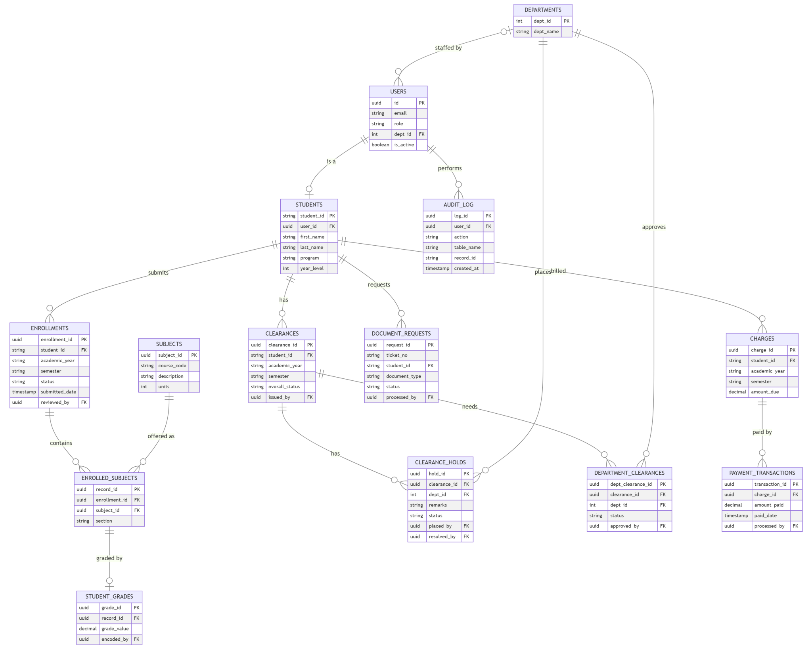
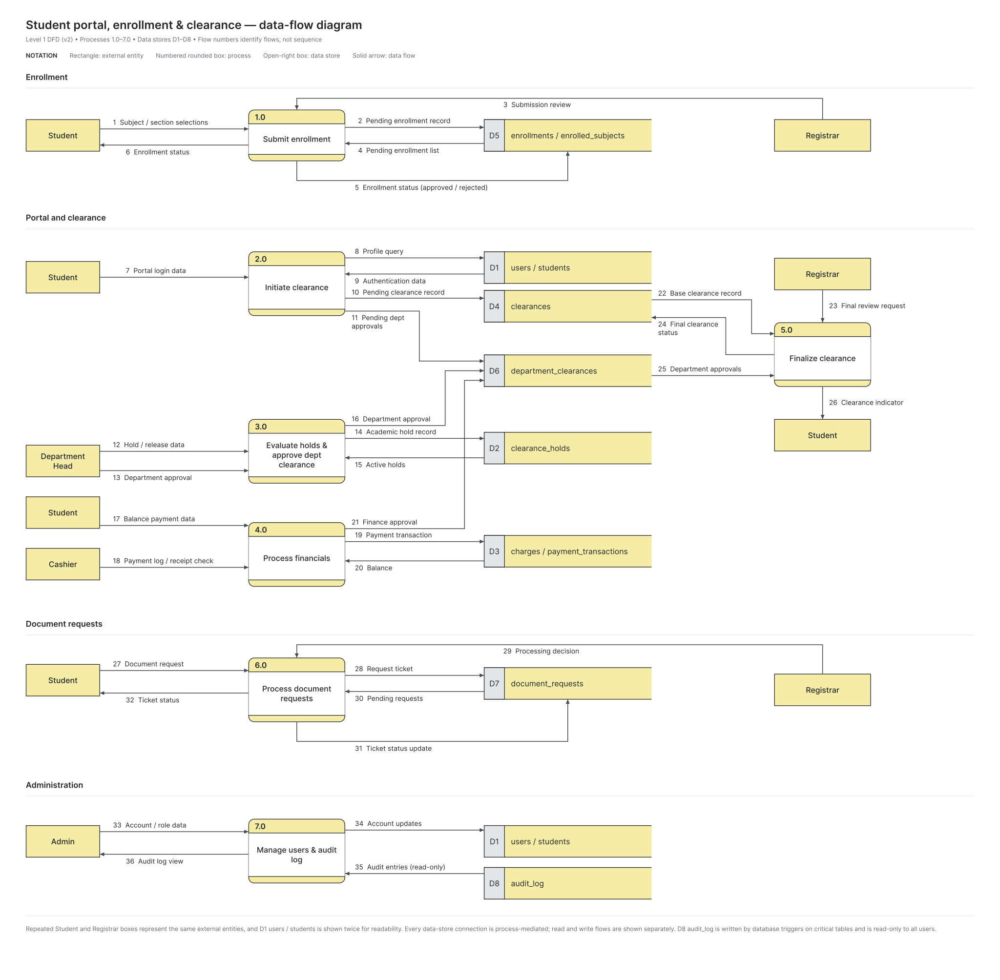
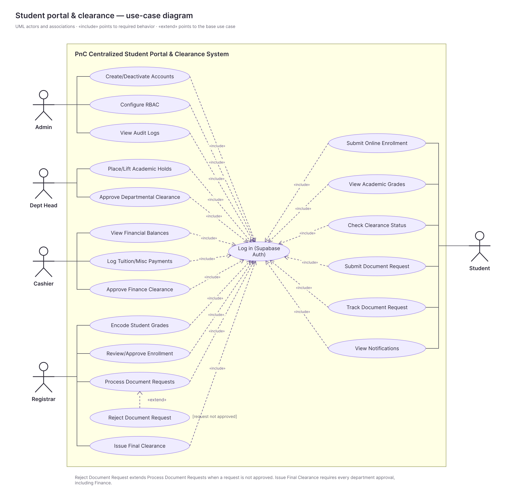

# System Requirements & Project Documentation

**Project Title:** Centralized Student Portal and Automated Clearance System
**Institution:** Pamantasan ng Cabuyao (PnC) - BS Computer Science
**Project Manager:** Abarquez, Justinbril
**Back-End Developer:** Cruzante, Aaron; Canayong, Ron
**Front-End Developer:** Esgana, Justine; Espedilon, Arvien; Dominado, Byrone
**Project Duration:** 12 Days (Rapid Application Development)
**Tech Stack:** Next.js, Tailwind CSS, Supabase (PostgreSQL), Vercel

---

## Part 1: Project Charter

### 1. Executive Summary

This project delivers a comprehensive, web-based university portal designed to eliminate physical queuing for enrollment, automate the student clearance process, and centralize grade viewing and document requests. Due to the accelerated 12-day deadline, the system uses a decoupled Backend-as-a-Service (BaaS) architecture to ensure rapid deployment, scalability, and security without sacrificing architectural integrity.

### 2. Project Objectives

* **Digitize Enrollment:** Allow students to submit their enrollment (subject and section selection) online and allow the Registrar to review and approve it, removing the need for physical queuing.
* **Automate Clearances:** Reduce physical clearance processing time by digitizing approvals across academic and financial departments.
* **Centralize Academic Data:** Provide a secure portal for students to view grades and academic standing in real time.
* **Streamline Requests:** Implement a ticketing system for document requests (e.g., Transcript of Records, Certificates) to eliminate physical line queuing.
* **Modernize Financial Tracking:** Enable the Cashier module to digitally tag payments and instantly lift financial holds.

### 3. Project Scope

**In-Scope:**

* Development of 6 core modules: Student Portal, Registrar, Cashier, Department, Admin, and Document Request System.
* Online enrollment submission (Student Portal) and enrollment approval (Registrar), as covered in the SRS.
* Database design normalized to the Third Normal Form (3NF).
* Role-Based Access Control (RBAC) ensuring strict data isolation.
* Implementation of system security protocols: Rate Limiting, Row Level Security, Brute-Force Protection, and SQL Injection prevention (parameterized queries).
* Live cloud deployment via Vercel.

**Out-of-Scope:**

* Integration with external payment gateways (credit cards, e-wallets); cashier transactions will be manually tagged by staff for this phase.
* Hardware procurement or physical kiosk setup.

### 4. Team Structure and Roles

* **Project Manager / Systems Analyst (1):** Oversees the RAD timeline, designs the system models (DFD, Use Case, Activity, and Class Diagrams), writes the SDLC plan, test plan, and ethical analysis, compiles the final IEEE documentation in parallel with development, and is the only person who merges dev into main for deployment.
* **Frontend Developers (3):** Develop UI/UX wireframes and storyboards and build responsive Next.js/Tailwind CSS components using mock data (stored in lib/mock-data.ts) for rapid prototyping.
* **Backend / Database Developers (2):** Own the ERD and 3NF PostgreSQL schemas, configure Supabase Authentication, implement Row Level Security (RLS) policies, build login lockout and rate limiting, implement the audit log, and connect live APIs.
* *Ownership note:* The PM reviews the ERD for consistency with the Class Diagram, but the Backend team is the owner of the ERD and 3NF tables so the work is not duplicated.

### 5. Deliverable Ownership

| Deliverable | Owner | Support |
| --- | --- | --- |
| SDLC Plan | Project Manager | - |
| DFD, Use Case, Activity, Class Diagrams | Project Manager | Backend team (review) |
| UI/UX Storyboard and Wireframes | Frontend team | Project Manager (review) |
| ERD and 3NF Tables | Backend team | Project Manager (review) |
| Software Testing Plan and Test Cases | Project Manager | All developers (unit tests for own modules) |
| Ethical Analysis | Project Manager | All members (input) |
| Prototype and Live Deployment | Backend team and Project Manager | Frontend team |
| IEEE References, Verification Reports, Team Monitoring Sheet | Project Manager | All members (peer evaluation) |

*Table data sourced from Project Charter.*

### 6. Milestone Schedule

| Phase | Description | Target Date |
| --- | --- | --- |
| **Phase 1** | System modeling (DFD, Use Case, Activity, Class), ERD/3NF design, UI/UX wireframes, database initialization. | Oct 2 |
| **Phase 2** | Auth setup, Role-Based Access Control (RLS), Admin/Student UI layouts, SDLC plan draft. | Oct 5 |
| **Phase 3** | Registrar (Grades/Docs/Enrollment), Cashier, and Department (Clearance) modules connected; Admin audit log implemented. | Oct 8 |
| **Phase 4** | Integration, QA testing, security hardening (SQL injection checks, login lockout, rate limiting, vulnerability patching), software testing plan and ethical analysis finalized. | Oct 10 |
| **Phase 5** | Live deployment to Vercel (dev merged into main by the PM), IEEE final paper compilation, plagiarism check, AI/anti-AI detector report, Team Monitoring Sheet (peer evaluation), final review. | Oct 12 |

## Part 2: Software Requirements Specification (SRS)

### 1. Introduction

**1.1 Purpose**
This document specifies the software requirements for the Centralized Student Portal and Automated Clearance System. It defines the functional and non-functional requirements to guide the development team and provide a clear baseline for the academic evaluation of the live prototype.

**1.2 Definitions, Acronyms, and Abbreviations**

| Term | Definition |
| --- | --- |
| **RBAC** | Role-Based Access Control: access to features and data is determined by the user's role. |
| **RLS** | Row Level Security: PostgreSQL feature that restricts which rows a user can read or modify. |
| **BaaS** | Backend-as-a-Service: hosted backend (Supabase) providing database and authentication. |
| **3NF** | Third Normal Form: a database normalization level that removes redundant and transitively dependent data. |
| **Hold** | A block placed on a student record by a department or the Cashier that must be lifted before clearance is granted. |
| **Ticket** | A unique tracking record created for each document request. |
| **SRS** | Software Requirements Specification. |

### 2. System Overview

The system is a cloud-native web application using Next.js for the frontend and Supabase (PostgreSQL) for the backend database and authentication. It facilitates secure data flow between students and university staff, ensuring that enrollment, clearance, and document retrieval processes are digitized, role-restricted, and secure.

**2.1 User Classes**

| User Class | Description |
| --- | --- |
| **Student** | Enrolled student who views grades, enrollment status, clearance, and submits requests. |
| **Registrar** | Encodes grades, approves enrollment, processes document requests, and issues final clearance. |
| **Cashier** | Views balances, logs payments, and tags financial records as Cleared. |
| **Department Head** | Reviews students pending academic clearance and places or lifts academic holds. |
| **Admin** | Manages user accounts and roles and reviews the audit log. |

**2.2 Assumptions and Constraints**

* The project must be delivered within a 12-day RAD schedule.
* The system is built on Next.js, Tailwind CSS, Supabase (PostgreSQL), and Vercel.
* Payments are manually tagged by Cashier staff; no external payment gateway is integrated.
* Users have internet access and a modern web browser.
* University-issued credentials are provisioned by the Admin through Supabase Auth.

**2.3 External Interfaces**

* **User interface:** Responsive web UI built with Next.js and Tailwind CSS, accessible by browser.
* **Database/Auth interface:** Supabase client (HTTPS) for PostgreSQL queries and Supabase Auth.
* **Hosting interface:** Vercel continuous deployment from the GitHub repository.

### 3. Functional Requirements

**3.1 Student Portal Module**

* **REQ-STU-01:** The system shall allow students to log in using university-issued credentials.
* **REQ-STU-02:** The system shall display the student's current enrollment status and academic grades securely.
* **REQ-STU-03:** The system shall provide a dashboard showing the real-time status of the student's clearance across all departments.
* **REQ-STU-04:** The system shall allow students to submit requests for specific academic documents and track the request status.
* **REQ-STU-05:** The system shall allow students to submit an online enrollment (select subjects and sections for the term) and track its approval status.

**3.2 Registrar Module**

* **REQ-REG-01:** The system shall allow the Registrar to encode and update student grades.
* **REQ-REG-02:** The system shall allow the Registrar to view and process incoming document requests from students.
* **REQ-REG-03:** The system shall enable the Registrar to issue final clearance approvals once all departmental and financial holds are cleared.
* **REQ-REG-04:** The system shall allow the Registrar to review, approve, or reject submitted student enrollments.

**3.3 Cashier Module**

* **REQ-CSH-01:** The system shall allow Cashier personnel to view a student's outstanding financial balances.
* **REQ-CSH-02:** The system shall allow Cashier personnel to log payments and tag financial records as "Cleared."
* **REQ-CSH-03:** The system shall instantly update the student's clearance status upon payment confirmation.

**3.4 Department Module**

* **REQ-DPT-01:** The system shall allow Department Heads to view students pending academic clearance.
* **REQ-DPT-02:** The system shall allow departments to place or lift specific academic holds (e.g., missing lab equipment, advising required).
* **REQ-DPT-03:** The system shall allow Department Heads to approve departmental clearance for a student once all of that department's holds are lifted. This approval is a prerequisite for REQ-REG-03.

**3.5 Admin Module**

* **REQ-ADM-01:** The system shall provide an Admin interface to create, update, and deactivate user accounts.
* **REQ-ADM-02:** The system shall implement strict Role-Based Access Control (RBAC) assigning users to Student, Registrar, Cashier, Department, or Admin roles.
* **REQ-ADM-03:** The system shall maintain a read-only audit log of all critical data changes.

**3.6 Document Request System**

* **REQ-DOC-01:** The system shall assign a unique tracking ticket to every new document request.
* **REQ-DOC-02:** The system shall update the ticket status automatically when the Registrar processes the document.

### 4. Non-Functional Requirements

**4.1 Security Requirements**

* **SEC-01 (Authentication):** Passwords shall not be stored in plaintext. The system shall use Supabase Auth (bcrypt hashing) for all credentials.
* **SEC-02 (Authorization):** The database shall enforce Row Level Security (RLS), enabled on every table, ensuring users can only query data authorized by their specific role.
* **SEC-03 (Brute-Force Protection):** The system shall implement account lockouts and exponential backoff for multiple failed login attempts (implemented via custom middleware/logic on top of Supabase Auth).
* **SEC-04 (Rate Limiting):** API endpoints shall be rate-limited to prevent Denial of Service (DoS) attacks (e.g., via Next.js middleware or Vercel firewall).
* **SEC-05 (SQL Injection):** All database access shall use parameterized queries through the Supabase client. Raw SQL built by string concatenation with user input is prohibited, and all user input shall be validated server-side.
* **SEC-06 (Secret Handling):** The Supabase `service_role` key shall never be used in frontend code or exposed to the browser. Only the anon key may be used client-side, and environment files (`.env.local`) shall never be committed to the repository.

**4.2 Performance & Deployment Requirements**

* **PER-01:** The application UI shall load in under 2.5 seconds on standard broadband connections.
* **PER-02:** Database queries for student grades and clearance statuses shall resolve in under 500 milliseconds.
* **PER-03:** The application shall be continuously deployed to a live Vercel production environment automatically upon merging code to the main branch. Merges from dev to main are performed by the Project Manager only.

**4.3 Data Privacy & Ethics**

* **ETH-01:** The system shall comply with standard data privacy principles (e.g., Data Privacy Act of 2012), ensuring student academic records are strictly confidential and inaccessible to peer student accounts.
* **ETH-02:** Data minimization shall be enforced; the system will only collect and display data strictly necessary for enrollment and clearance procedures.

## Part 3: System Architecture & Modeling

### 1. Entity Relationship Diagram (3NF)

This schema integrates the `ENROLLMENTS` and `ENROLLED_SUBJECTS` tables to support online enrollment workflows, along with `DEPARTMENT_CLEARANCES`, `CHARGES`, `PAYMENT_TRANSACTIONS` and `AUDIT_LOG`. It maintains strict 3NF compliance and provides clear Foreign Key relationships for backend RLS implementation.



*Figure 1. Entity Relationship Diagram (3NF). [Open full size](diagrams/erd.svg)*

### 2. Data Flow Diagram (Level 1)

Illustrates how data moves between the students, university staff, system internal logic, and the Supabase data stores for enrollment, authentication, clearance, grades, document requests and administration.



*Figure 2. Level 1 Data Flow Diagram. [Open full size](diagrams/dfd.svg)*

### 3. Use Case Diagram

Maps out the functional interactions and strict system boundaries for the Student, Registrar, Cashier, Department Head, and Admin roles.



*Figure 3. Use Case Diagram. [Open full size](diagrams/ucd.svg)*

## Part 4: Developer Onboarding & Workflow Guide

### First-Time Installation

You only need to do this once.

1. **Install Prerequisites:** Ensure you have Node.js installed (download the LTS version) and Git installed on your computer.

2. **Clone the Repository:** Open your terminal (or VS Code terminal) and run:

```bash
git clone https://github.com/brtbrt123/sv-student-portal.git
cd sv-student-portal
```

3. **Install Dependencies:** Download all the required packages (Next.js, Tailwind, Supabase client) by running:

```bash
npm install
```

4. **Connect to the Database (Crucial Step):** You cannot run the app without the database keys.

   * In the root folder of the project, create a new file and name it exactly `.env.local`
   * Ask the Project Manager for the Supabase keys and paste them into this file like this:

```env
NEXT_PUBLIC_SUPABASE_URL=your-supabase-url-here
NEXT_PUBLIC_SUPABASE_ANON_KEY=your-supabase-anon-key-here
```

   * *Note: Never upload this file to GitHub.* *It is ignored automatically.* *Only the anon key goes in this file.* *NEVER put the Supabase service_role key in frontend code or in any NEXT_PUBLIC_ variable.* *The anon key is only safe because Row Level Security (RLS) is enabled on every table, so Backend developers must enable RLS on each new table.*

5. **Start the Local Server:**

```bash
npm run dev
```

Open your browser and go to `http://localhost:3000`. You should see the app running!

### Understanding the Folder Structure

Do not create random folders. We have a strict structure so we do not accidentally overwrite each other's code.

* **`app/`**: This is where all the website pages live.
* **`app/(auth)/login/page.tsx`**: The login screen. The URL will just be `/login`.
* **`app/(modules)/`**: This is where our 6 core systems live. If you are assigned to build the Cashier module, you will ONLY write code inside the `app/(modules)/cashier/` folder (`page.tsx` and any files that belong to that module).
* **`components/`**: Do not put huge chunks of UI code in the `app/` folder. If you make a button, a navigation bar, or a data table, put it in `components/ui/` and then import it into your page. This allows everyone to reuse the same button.
* **`lib/`**: This holds background configuration. `supabase.ts` connects us to the database, `utils.ts` holds formatting functions (like making a date look pretty), and `mock-data.ts` holds the shared mock data used while the live database is not yet connected to your module.
* **`types/`**: This holds TypeScript definitions so VS Code can auto-complete database column names for you.

### The Golden Rule of Git (How to Write Code)

**NEVER WRITE CODE ON THE `main` OR `dev` BRANCH.**

When you pick a task from the Kanban board, follow this exact process:

1. Make sure you have the latest code from the team:

```bash
git checkout dev
git pull origin dev
```

2. Create a new branch for your specific task (e.g., you are building the cashier table):

```bash
git checkout -b feature/cashier-table
```

3. Write your code, save, and test it locally.

4. Upload your finished code:

```bash
git add .
git commit -m "feat: added cashier payment table"
git push origin feature/cashier-table
```

5. Then go to GitHub, click **Compare & pull request**, and ask a teammate to review and merge your code into `dev`.

### Deployment (Merging to `main`)

* The live Vercel site deploys automatically whenever code is merged into `main`.
* Only the Project Manager merges `dev` into `main`, after the team confirms that `dev` is tested and working.
* Planned merges to `main`: end of each phase (Oct 2, 5, 8, 10) and the final deployment on Oct 12.
* If you notice a bug in `dev`, tell the Project Manager before the merge. Do not push fixes directly to `main`.